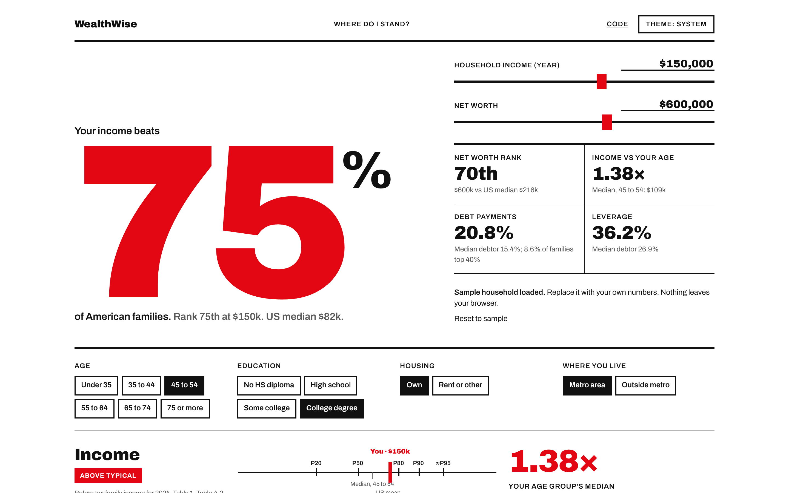

# WealthWise


[](https://osgk.com/wealthwise/)

**Where do I stand?** Move a few sliders and see how your household ranks against 135 million US families, using the Federal Reserve's 2025 Survey of Consumer Finances.

### [Open the live app →](https://osgk.com/wealthwise/)

<picture>
  <source media="(prefers-color-scheme: dark)" srcset="docs/screenshot-dark.png">
  
</picture>

## What it does

* **Ranks you** on income and net worth against all US families, then against your age, education, housing and metro peers.
* **Benchmarks** home equity, retirement savings, debt ratios, credit cards, student loans and spending.
* **Cites everything.** Every number points to a table and page in the Fed report.
* **Stays private.** No server, no tracking, no cookies. Inputs live only in your browser.

## Run it

Open `index.html` in a browser. That's it.

```bash
python3 build.py   # optional: inlines CSS and JS into one file, dist/index.html
npm test           # Node 18+, built in test runner, zero dependencies
```

## How it works

```
js/data.js     Benchmarks from the report, each commented with its source table
js/core.js     Pure functions: parsing, formatting, log slider scales, percentile interpolation
js/app.js      DOM wiring: controls, meters, copy, theme toggle
css/style.css  Swiss poster design tokens, light and dark
tests/         Unit tests for core.js and data integrity
```

**Percentiles.** The report publishes exact cutoffs (Table A.2: P20 to P90 for income, P25 to P90 for net worth). Each group's published median is added as an approximate midpoint, for example the top decile's median income stands in for P95. Values are interpolated on a log scale. Above P95 the report has no finer detail, so the app shows 95+. Ranks are approximate, within a few points.

**Known limits**
* Cutoffs use "usual" income; users enter last year's actual income.
* Percentiles are national. Peer comparisons use group medians and means, not within group percentiles.
* Retirement averages by age cover IRAs and DC plans for families under 65.

## Roadmap

- [ ] Within group percentiles from the SCF public microdata, with survey weights
- [ ] 2022 vs 2025 toggle to show how your rank moved
- [ ] Shareable result link and summary card

## Source

[*Changes in U.S. Family Finances from 2022 to 2025: Evidence from the Survey of Consumer Finances*](https://www.federalreserve.gov/publications/files/scf26.pdf). Aladangady, A., Bricker, J., Chang, A. C., Goodman, S., Li, G., Moore, K. B., Reber, S., Volz, A. H., and Windle, R. A. Board of Governors of the Federal Reserve System, October 2026. https://doi.org/10.17016/8799.1

---

Built by [Lorenzo T Geraci](https://www.linkedin.com/in/lor3nzo/). MIT licensed.
